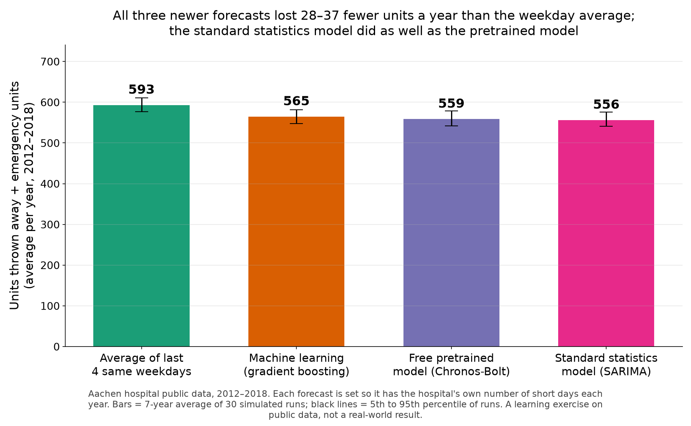

# Platelet-forecast

**Do better forecasts reduce platelet waste? A simulation over seven test years of public data from a German university hospital**

An educational project that forecasts daily platelet demand and simulates a hospital platelet inventory, using public data from one German hospital.

> **Educational and advisory only. Not for clinical use.**
> This is a learning project. It is not a clinical tool, not a blood-bank ordering system and not advice for any hospital. Nothing here should be used to decide whether a patient receives a unit, or how many units a real blood bank should order or keep. It uses only public, aggregate data and has never been connected to any hospital system.

A manuscript is in [`paper/`](paper/). **Draft v11** (latest) reports a pre-specified re-analysis of previously analysed data that followed a written analysis plan, registered retrospectively on OSF after the analyses ([osf.io/phq42](https://osf.io/phq42/)). Draft v10 is the previous version; draft v9 is the earlier exploratory study.

## Latest: draft v11 (re-analysis per a written analysis plan)

According to the author's file time stamps, the analysis plan ([`prereg/osf_preregistration_final.md`](prereg/osf_preregistration_final.md)) was finalised and its 35 inputs fingerprinted ([`prereg/osf_prereg_input_hashes.txt`](prereg/osf_prereg_input_hashes.txt)) before the analyses were run on 14 November 2026. Those time stamps cannot be independently verified, and the analysis code was written after the plan. The plan was **registered retrospectively** on OSF later the same day, **after** the analyses: https://osf.io/phq42/, DOI [10.17605/OSF.IO/PHQ42](https://doi.org/10.17605/OSF.IO/PHQ42). The paper states this as a limitation and as deviation D8. The file names keep the word "prereg" from when they were written; the registration itself is retrospective.

- **The calibrated simulation failed its own preset check.** Simulated waste was 5.22% against 9.74% recorded; emergency units per short day were 5.00 against 8.82; the weekday pattern missed its limit (TVD 0.226 against 0.20). Every result is conditional on that.
- **Aachen: no forecast was shown to waste less than last year's standing order** (5.30% waste). SARIMA −0.33 points (95% CI −0.88 to +0.22), Chronos-Bolt −0.12, detrended gradient boosting +0.07, gradient boosting +0.17. None was shown to be equivalent either.
- **Stanford (public `pip` data): estimates favoured the forecasts by 1.4–2.3 points, but were too uncertain after the Holm correction** (adjusted p ≥ 0.10). The plan's label for this is "consistent null", which does not mean no effect; the comparator was weak there.
- **The answer depends on the delivery calendar (exploratory).** Under the hospital's documented Tue–Sat calendar, SARIMA wasted 2.47 points less than the standing order (95% CI −3.52 to −1.42); under Mon–Fri, 1.77 less. The calibrated Mon–Sat calendar is the one that leaves forecasts least room to help.

Files:
- [`paper/draft_v11_layout.pdf`](paper/draft_v11_layout.pdf) and [`paper/supplement_v11_layout.pdf`](paper/supplement_v11_layout.pdf) (latest); what changed: [`paper/changes_v10_to_v11.md`](paper/changes_v10_to_v11.md);
- previous version: [`paper/draft_v10_layout.pdf`](paper/draft_v10_layout.pdf) and [`paper/supplement_v10_layout.pdf`](paper/supplement_v10_layout.pdf);
- the journal plan: [`paper/journal_plan_v10.md`](paper/journal_plan_v10.md);
- deviations: [`paper/prereg_deviations.md`](paper/prereg_deviations.md);
- the note to add to the OSF registration: [`paper/osf_update_text.md`](paper/osf_update_text.md);
- the results in plain English: [`paper/revision_results_summary.md`](paper/revision_results_summary.md).

## What it does

Platelets expire within days, so blood banks balance waste (units that expire) against shortages (emergency orders). This project asks a simple question: **do better forecasts cut simulated waste when the number of short days is held fixed?**

1. **Forecasts** of the next 1–4 days of platelet use:
   - simple baselines (yesterday; last-7-day average; same weekday last week; average of the same weekday over the past 4 weeks);
   - a standing weekday order (last year's mean use for each weekday);
   - a standard statistical model (SARIMA, with a weekly season);
   - machine learning (gradient boosting, and an exploratory detrended variant);
   - a free pretrained forecasting model (Chronos-Bolt, zero-shot);
   - the source authors' own published LASSO and neural-network forecasts, as a reference.
2. **An inventory simulation** that feeds each forecast into the same ordering rule. It includes blood groups, substitution between groups, short deliveries and units arriving with different amounts of shelf life left, each repeated over 30 random runs.
3. **A fair comparison.** Every forecast is matched to the hospital's own number of short days in each year, and then compared on waste and on wasted plus emergency units.

All forecasts are tested out of sample: each test year (2012–2018) uses only data from earlier days.

## Data

Daily platelet counts from **University Hospital Aachen, Germany, 2008–2018**: units transfused, wasted and bought in an emergency. No patient-level data.

> Source: Schilling M, Rickmann L, Hutschenreuter G, Spreckelsen C. Reduction of Platelet Outdating and Shortage by Forecasting Demand With Statistical Learning and Deep Neural Networks: Modeling Study. *JMIR Med Inform* 2022;10(2):e29978. doi:[10.2196/29978](https://doi.org/10.2196/29978). PMCID: [PMC8848235](https://pmc.ncbi.nlm.nih.gov/articles/PMC8848235/). Multimedia Appendix 1, licensed under [CC BY 4.0](https://creativecommons.org/licenses/by/4.0/).

The original appendix is included unchanged in `data/public/`, with a trimmed CSV copy (columns removed). See [`data/README.md`](data/README.md). This project is not affiliated with or endorsed by University Hospital Aachen or the source authors.

## Results in brief (draft v9, exploratory)

Simulation results on one German hospital's data. They are a learning exercise, not evidence for any hospital. Figures are 7-year means for 2012–2018, at each year's recorded number of short days, unless noted.

- **No demonstrated waste difference at the recorded shortage frequency.** SARIMA, Chronos-Bolt and gradient boosting each wasted less than the 4-week weekday average in 4 of 7 years (8.4%, 8.4% and 8.6% against 8.9%). Every 95% CI included zero, and 7 years could detect only gaps of about 1 point.
- **A simple standing order captured most of that gap.** It wasted 8.5%. Against it, the three newer forecasts were within about 0.1 points, and every CI included zero.
- **Exploratory analyses, added after internal review.** At a stricter 20 short days a year, SARIMA and Chronos-Bolt wasted less than the 4-week average in all 7 years; against the standing order that gain disappeared. Under four other delivery calendars, SARIMA kept a smaller edge over the standing order (about 0.3–0.4 points), statistically clear only under a Monday-to-Saturday calendar. Under heavy delivery shortfalls, all three newer forecasts wasted less than the 4-week average in all 7 years, so the null waste result is specific to the base assumptions.
- **Accuracy is not the same as less waste.** A detrended gradient-boosting model was more accurate for 2- and 4-day totals but wasted more under the documented calendar.
- **What moved waste most.** Shelf life on arrival and the delivery calendar. Raising the share of short-life units from the assumed 30% to a calibrated 43% increased weekday-average waste by about 1.3 points. Calendars with no 4-day weekend order roughly halved waste. The choice of forecast mattered less.
- **Reality check.** A hospital-like standing order came close to the hospital's average recorded waste (8.5% simulated, 9.7% recorded) but missed single years by up to 5.1 points, always needed fewer emergency units than were recorded, and did not match the recorded weekday pattern of waste. So the simulation is useful for comparing options, not for predicting real savings.



More charts are in [`charts/`](charts/), and summary tables and run logs are in [`results/`](results/). The manuscript is [`paper/draft_v9_layout.pdf`](paper/draft_v9_layout.pdf), with a supplement at [`paper/supplement_v9_layout.pdf`](paper/supplement_v9_layout.pdf).

## How to rerun

You need Python 3.13. Everything runs on a normal laptop CPU. The early scripts take about 10 minutes in total; the later multi-year simulations (especially 21 and 26) take longer.

```bash
python3 -m venv .venv
source .venv/bin/activate            # Windows: .venv\Scripts\activate
pip install -r requirements.txt

export PYTHONPATH=scripts            # Windows (PowerShell): $env:PYTHONPATH="scripts"
python scripts/generate_synthetic_data.py   # synthetic example data (already included)
python scripts/01_baselines.py              # milestone 1: pipeline on synthetic data
python scripts/02_aachen_real_data.py       # milestone 2: real Aachen data, 2018 holdout
python scripts/03_realistic_sim.py          # milestone 3: blood groups, short deliveries, 30 runs
python scripts/04_second_test_year.py       # milestone 4: second test year (2017)
python scripts/05_better_model.py           #   extra features, day-by-day cushion
python scripts/05b_pretrained_model.py      #   Chronos-Bolt (skips cleanly if not installed)
python scripts/06_ordering_rule.py          #   expiry-aware ordering
python scripts/07_us_rules_sim.py           #   US rules applied to Aachen demand
python scripts/08_multiyear_test.py         # milestone 5: every test year 2012-2018
python scripts/08b_summary_tables.py
python scripts/09_reality_check.py          #   simulation vs recorded hospital figures
python scripts/10_us_one_change.py          #   US rules one change at a time
python scripts/11_paper_tables.py           #   summary tables
python scripts/12_sarima.py                 # milestone 6: SARIMA forecasts
python scripts/13_multiyear_sarima.py       #   SARIMA in the 2012-2018 test
python scripts/14_cost_weights.py           #   emergency units weighted 0-10x
python scripts/15_life_on_arrival_sweep.py  #   shelf life on arrival swept 0-100%
python scripts/16_low_titer_bound.py        #   bound on US group O titer limits
python scripts/17_tables_charts_v3.py       #   summary tables and charts
python scripts/19_prior_year_cushion.py     # milestone 8: cushion size fixed from the previous year
python scripts/20_horizon_accuracy_and_stats.py  #   2- and 4-day accuracy, Holm, year-level tests
python scripts/21_multiyear_robustness.py   #   2012-2018 comparison under other assumptions
python scripts/24_sarima_runner_up.py       #   SARIMA check: runner-up AIC order (results/m8/24_*)
python scripts/22_tables_v4.py              #   summary tables
python scripts/23_charts_v4.py              #   simple charts (charts/m8_*.png)
python scripts/26_weekend_delivery.py       # milestone 9: other delivery calendars and the standing order
python scripts/27_gb_detrended.py           #   detrended gradient boosting
python scripts/28_cushion_diagnosis.py      #   day-by-day cushion check
python scripts/29_v6_numbers.py             #   lost-unit decomposition and power
python scripts/25_charts_paper.py           #   paper-size redraws of the charts
python scripts/30_tables_v6.py              #   v6 tables from saved results (no new simulation)
python scripts/31_charts_v6.py              #   v6/v7/v9 charts, including the service-level and calendar figures
python scripts/34_tables_v8.py              #   standing-order tables from saved results
```

## Reproduce draft v10 and v11

Drafts v10 and v11 use the same results; v11 changes only the wording, three figure footnotes and the reference to the registration. Tested with **Python 3.13.5** on Linux, CPU only.

Two environments are used:

- **`.venv`** for everything except Chronos-Bolt: `python3.13 -m venv .venv && .venv/bin/pip install -r requirements.txt`.
- **`.venv-chronos`** only for the Stanford Chronos-Bolt forecasts (script `study2/scripts/10b_m10_chronos.py`; chronos-forecasting 2.3.2 and torch, CPU): `python3.13 -m venv .venv-chronos && .venv-chronos/bin/pip install -r requirements.txt chronos-forecasting==2.3.2 torch`. The Aachen Chronos-Bolt forecasts are cached in `results/m5/`, so they do not need it.

**1. Cached forecasts the m10 scripts read.** Script 40 reuses earlier forecasts without refitting their settings. Gradient boosting is refitted in the run itself, and the Aachen Chronos-Bolt forecasts are included (`results/m5/chronos_forecasts_2010-12-31_2018-12-30.csv`). The SARIMA and detrended gradient-boosting forecasts are not included (see `.gitignore`), so create them first, from the repository root:

```bash
export PYTHONPATH=scripts
.venv/bin/python scripts/12_sarima.py               # results/m6/12_sarima_forecasts_<year>.csv
.venv/bin/python scripts/27_gb_detrended.py         # results/m9/27_gb_detrended_forecasts_<year>.csv
```

**2. The m10 analyses (Aachen), in this order:**

```bash
.venv/bin/python scripts/37_m10_selftest.py           # simulator self-test on the SYNTHETIC series only
.venv/bin/python scripts/38_m10_calibration.py        # calibration on 2009-2011, standing order only
.venv/bin/python scripts/39_m10_validation.py         # validation on 2012-2018 (it fails; reported)
.venv/bin/python scripts/40_m10_run_comparisons.py    # primary, secondary and sensitivity simulations (slow)
.venv/bin/python scripts/41_m10_stats.py              # mixed models, Holm, labels, secondary tables
.venv/bin/python scripts/42_m10_charts_descriptive.py # descriptive accuracy and the four m10 charts
#   (add --charts-only to redraw the charts from the saved results without recomputing accuracy)
```

**3. Stanford (second site):**

```bash
.venv/bin/python study2/scripts/10_m10_forecasts.py          # standing order and detrended GB forecasts
.venv-chronos/bin/python study2/scripts/10b_m10_chronos.py   # Chronos-Bolt forecasts
.venv/bin/python study2/scripts/11_m10_stanford_replication.py
```

**4. Tables, number checks and the paper** (pandoc 3.x, python-docx, Pillow and LibreOffice for the PDFs):

```bash
.venv/bin/python scripts/43_tables_v10.py             # paper tables (used by v10 and v11)
.venv/bin/python scripts/44_check_v10_numbers.py      # every number in draft v10 vs the results files
.venv/bin/python scripts/45_check_v11_numbers.py      # every number in draft v11 vs the results files
cd paper
python3 build_paper.py v11            # draft_v11.md/.docx and supplement_v11.md/.docx (use v10 for draft v10)
python3 build_paper.py v11 --layout   # journal-style draft_v11_layout.pdf and supplement_v11_layout.pdf
```

The number checks write `paper/refcheck/v10_number_check.md` and `paper/refcheck/v11_number_check.md`. Seeds are fixed (simulation 1000-1029; bootstrap 20261114 and 20261115), so a rerun with the pinned versions should give the same result files.

**Archive:** this version (v0.11.0) is archived on Zenodo: https://doi.org/10.5281/zenodo.24237979.

Scripts 32, 33, 35, 36, 44 and 45 only check that numbers quoted in a given draft match the result files; they are not needed to reproduce the results.

Notes:

- Scripts must run in this order, because some read the results of earlier ones.
- Script 18 is not included and is not used in the paper.
- If gradient boosting runs very slowly on a busy machine, set `OMP_NUM_THREADS=1` before running the scripts (it avoids thread oversubscription and does not change results).
- **Chronos-Bolt is optional.** Its forecasts for 2011–2018 are cached in `results/m5/chronos_forecasts_2010-12-31_2018-12-30.csv`, so script 08 does not need PyTorch. To recompute them, delete that file and install the optional packages listed in `requirements.txt`.
- Random runs use fixed seeds, so a rerun with the pinned versions should reproduce the numbers above.
- Large intermediate files (per-run tables, daily inventory traces and cached SARIMA or detrended-boosting forecasts) are not included. The scripts recreate them, and `.gitignore` keeps them out of the repository.

## Script map

| Scripts | Milestone / role | Results |
|---|---|---|
| `generate_synthetic_data.py`, `01_baselines.py` | 1. Pipeline on synthetic data | `results/metrics_combined.csv` |
| `02_aachen_real_data.py` | 2. 2018 holdout on Aachen data | `results/aachen/` |
| `03_realistic_sim.py` | 3. Blood groups, short deliveries, 30 runs | `results/realistic/` |
| `04`–`07`, `lib_m4.py` | 4. Second test year, model variants, US rules | `results/m4/` |
| `08`, `08b`, `09`, `10`, `11`, `lib_m5.py` | 5. Seven test years, reality check, US one-change | `results/m5/` |
| `12`–`17` | 6. SARIMA, cost weights, life-on-arrival sweep | `results/m6/` |
| `19`–`24` | 8. Prior-year cushion, robustness, accuracy tests | `results/m8/` |
| `25`–`36` | 9. Delivery calendars, standing order, detrended boosting, paper charts and checks | `results/m9/`, `charts/`, `paper/` |
| `37`–`44`, `lib_m10.py`; `study2/scripts/10`–`11`, `lib_s2.py` | 10. Calibrated re-analysis per the analysis plan, Stanford replication, v10 tables and checks | `results/m10/`, `study2/results/s2m10/`, `charts/m10_*.png`, `paper/` |

Shared helpers are `scripts/lib_m4.py`, `scripts/lib_m5.py` and `scripts/lib_m10.py`.

## Folder layout

```
README.md          this file
LICENSE            MIT licence for the code
CITATION.cff       how to cite this repository
requirements.txt   pinned Python packages
data/              public Aachen data (CC BY 4.0) and synthetic example data
scripts/           analysis code (01-17, 19-44, plus shared helpers)
charts/            key charts, including those used in the paper
results/           summary tables and run logs for each milestone (m10 = v10 re-analysis)
study2/            Stanford replication code and results (no data files)
prereg/            the analysis plan and its input fingerprints (registered on OSF after the analyses)
paper/             draft v10 (sources, Word, PDF), journal plan, deviations, OSF note; draft v9 layout PDFs
```

## Main assumptions and limits

- **Simulated blood groups.** The data have no blood groups, so groups were simulated from population shares.
- **Assumed shelf life on arrival.** It is not recorded; the base case assumes 70% of units arrive with 4 usable days and 30% with 3.
- **No real orders or stock.** These are not in the public data, so ordering is simulated. Emergency units are always available.
- **Hidden demand.** Delayed or cancelled transfusions are not in the data.
- **The same cushion on every order.** Thursday's 4-day weekend order gets the same cushion as a 2-day order.
- **"US rules" runs** apply US practice to German demand. They are not a study of a US hospital.
- **One hospital, 2008–2018.** The results may not carry over to other hospitals or later years.
- **The simulation does not reproduce the hospital's year-level or weekday pattern.** Rankings are conditional on these mechanics.

## Licence and citation

- **Code:** MIT licence (see `LICENSE`).
- **Data:** CC BY 4.0, Schilling et al. 2022 (see above).
- **Citation:** if you use this work, please cite it using `CITATION.cff` and also cite the data source. This version (v0.11.0) is archived on Zenodo: https://doi.org/10.5281/zenodo.24237979. The analysis plan is registered (retrospectively) on OSF: https://doi.org/10.17605/OSF.IO/PHQ42.

Author: Liam Dixon, independent researcher ([ORCID 0009-0003-0610-197X](https://orcid.org/0009-0003-0610-197X)). Personal, educational project, not funded or endorsed by any employer.
