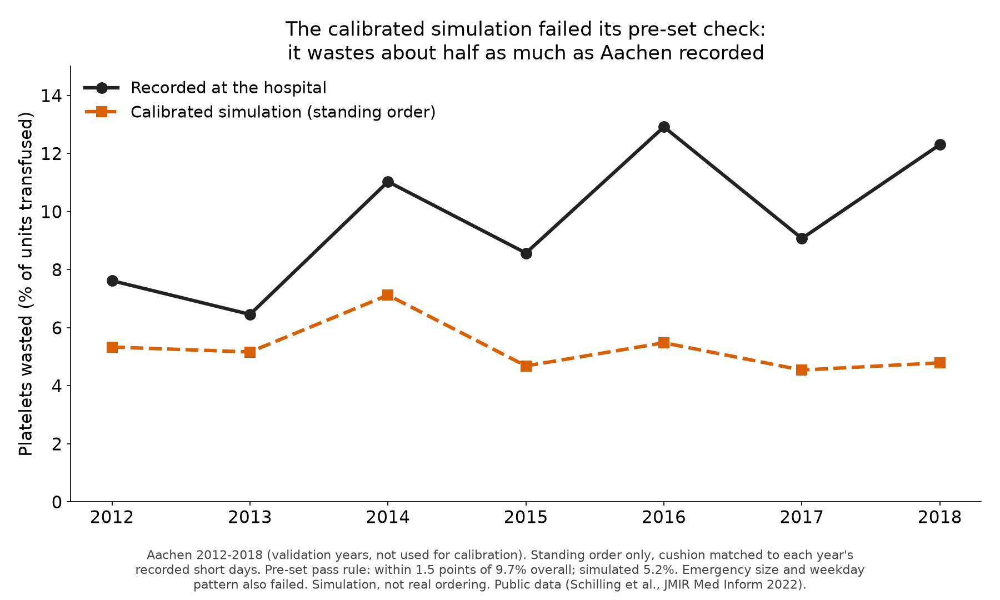

**Liam Dixon**, Medical Laboratory Technician, Independent researcher. ORCID: 0009-0003-0610-197X. Contact: dixonlj1993@gmail.com

**Educational analysis of public data.** This is a learning exercise. It is not a clinical tool, not blood-bank ordering advice and not a recommendation for any hospital. Nothing here should be used to decide whether a patient receives a unit, or how many units a real blood bank should order or keep.

**Running title:** Platelet forecasts versus a standing order. **Article type:** Original Article (prepared for *Transfusion Medicine*). **Analysis plan:** finalised before the analyses were run; registered on OSF Registries afterwards, \[OSF DOI\]. **Display items:** 3 tables, 3 figures. **Supplement:** Supplement v10.

# Abstract

**Objectives.** To test, following an analysis plan finalised beforehand (registered afterwards), whether forecasts of platelet use waste fewer units than a standing order based on last year's use, at matched shortage frequency.

**Background.** Platelets expire within days. Forecasting is often proposed to reduce waste, but a simple standing order is a fair comparator, and our earlier work on these data was exploratory.

**Methods/Materials.** Retrospective simulation using public daily counts from a German university hospital (test years 2012--2018) and two United States hospitals (2014--2015). Four forecasts (gradient boosting, detrended gradient boosting, a seasonal time-series model and a pretrained model) drove an inventory simulation calibrated on 2009--2011. The primary outcome was waste (percentage of units transfused) at each year's recorded shortage days, forecast minus standing order, with Holm correction.

**Results.** The calibrated simulation failed all three preset checks: waste 5.22% simulated against 9.74% recorded, 5.00 against 8.82 emergency units per shortage day, and a weekday-pattern distance of 0.226 (limit 0.20); year-by-year correlation was 0.25. At the German hospital (standing order waste 5.30%), no forecast was shown to differ from the standing order or to be equivalent to it: seasonal model −0.33 points (95% confidence interval −0.88 to +0.22), pretrained −0.12, detrended boosting +0.07, boosting +0.17. At the United States site all four estimates favoured the forecasts, by 1.40 to 2.29 points, but every Holm-adjusted p-value was 0.10 or more: by the planned rule, a consistent null.

**Conclusion.** A forecast advantage over a standing order was not demonstrated at either site, conditional on a simulation that failed validation.

**Keywords:** platelet inventory; demand forecasting; waste; simulation; analysis plan; public data

# 1. Introduction

Platelets can be stored for only 5 to 7 days at room temperature (1), and testing and transport use part of that time (2). Blood banks therefore trade waste against shortage: a larger safety stock means fewer emergency orders but more outdated units. Reported platelet outdating is often 10% to 20% (3). University Hospital Aachen, Germany, wasted 10.1% of platelet units over 2008--2018 and bought 6.5% as emergency purchases (4).

Forecasting is a common proposal. Schilling and colleagues used LASSO regression and a recurrent neural network on the public Aachen data and reported about 5% simulated waste (4). Guan and colleagues linked a forecast to ordering at Stanford and reported that expiry could fall from 10.5% to 3.2% (2). Others compared forecasting models on Canadian, Iranian or Chinese data (5--7), and inventory optimisation has a longer history (8).

Two problems make these results hard to read. First, the comparator is often weak. A blood bank that does not forecast is not ordering at random; a common practice is a standing order that follows past use by weekday. Second, studies that try many models, targets and settings can find a "win" by chance. In our own exploratory work on the Aachen data, several newer forecasts beat a 4-week weekday average, but a standing order based on last year's weekday averages matched them to within about 0.1 points, and that comparison was added after the results were seen. Two independent reviews also found that the simulation did not reproduce the hospital's record and that its ordering rule favoured some forecasts on weekend orders.

We therefore wrote and finalised an analysis plan for a confirmatory re-analysis before running it (9). The plan fixed the comparator (the standing order), the outcome, the shortage target, a fairer ordering rule, a calibration procedure with pass or fail criteria, the statistical model, the multiplicity correction, the labels for each result and a second site. The primary question (RQ1) was: in a calibrated simulation at a matched shortage frequency, does any of four forecasts waste fewer platelets than the standing order? This paper reports the answer as planned, including results that were disappointing.

# 2. Materials and methods

## 2.1 Design, analysis plan and registration

This is a retrospective simulation study using public data; no people were studied. The analysis plan was finalised and its inputs fingerprinted before the confirmatory analyses were run: on the analysis computer, the SHA-256 manifest of 35 input files is time-stamped 03:41 and the final plan 04:04 (US Eastern time) on 14 November 2026, and the analyses ran the same day between 04:30 and 05:10. The plan was registered on OSF on 14 November 2026, after those analyses were run (9); this was itself a departure from the plan, which said to register first (D8 in Table 3). The plan discloses that the author had already analysed earlier, uncalibrated versions of these data, so the study is confirmatory with partial foreknowledge. Eight deviations from the plan are listed in Table 3; none changed the primary comparator, outcome, matching target, ordering rule, model or correction. Reporting follows the STRESS checklist for simulation studies (10) (Supplement S8).

## 2.2 Data

**Aachen (primary site).** Daily counts from University Hospital Aachen, 1 January 2008 to 31 December 2018 (4,018 days, no missing dates), released under CC BY 4.0 with the source paper (4). The file gives hospital-day totals of units transfused, units wasted as outdated and units bought in an emergency, with no patient-level data or blood groups. Mean use was 11.50 units a day. A "short day" is a day with at least one emergency purchase. Each year was scored from 8 January to 18 December after a one-week warm-up.

**Stanford (second site).** The example data in the public `pip` R package (11), from two Stanford hospitals, accompanying Guan and colleagues (2). It gives daily units transfused (about 35 a day) but no stock, expiry, order or emergency data. The test window was 8 January 2014 to 31 May 2015 (509 days).

## 2.3 Forecasts and comparators

All Aachen forecasts were reused unchanged from the exploratory study; none was refitted or tuned. Each was made at the end of a day for the next 1 to 4 days, using only data known that day, with models trained on earlier years only.

- **Standing order (primary comparator):** for each target day, the previous calendar year's mean use on that weekday.
- **4-week weekday average (secondary comparator):** mean use on the same weekday over the past 4 weeks.
- **Gradient boosting** (scikit-learn `HistGradientBoostingRegressor` (12)) with calendar, lag and holiday features and fixed settings.
- **Detrended gradient boosting:** the same model forecasting the difference from the past-28-day mean, because tree models cannot forecast above their training range and use rose over the decade.
- **SARIMA:** a weekly seasonal time-series model (statsmodels (13)), with the order chosen by AIC from four preset candidates on earlier years.
- **Chronos-Bolt** (`amazon/chronos-bolt-small`): a pretrained forecasting model used as published, with up to 512 days of history and the mean forecast (14,15). Its training data are not public, and the Aachen file has been public since 2022, so it may have seen these data.

The source authors' LASSO and neural-network forecasts, which used clinical inputs, were reference comparisons only (Supplement S3).

## 2.4 Inventory simulation and ordering rule

The simulation keeps units in stock by age. Orders arrive two days after they are placed, units are issued oldest first, and any gap is filled by an emergency purchase. Blood groups were simulated from German population shares, with ABO-identical units preferred, RhD-negative units for RhD-negative patients and a published substitution order (16--18). Thirty runs with fixed random seeds were shared across all ordering policies, so each policy faced the same random events.

On each ordering day the order tops stock up to the forecast for the days it must cover, plus a safety cushion. In the **primary rule (R1)**, the cushion is *k* times the forecast's mean absolute error for totals of that order's length in the previous year, so a 4-day weekend order gets a cushion sized to 4-day errors. The constant cushion of the exploratory study (R2) and an age-aware rule that ignores stock projected to expire (R3) were secondary.

## 2.5 Calibration and validation

The Aachen file has no daily orders or stock, so the hospital's ordering cannot be replayed. Instead, five uncertain settings were calibrated: the delivery calendar (five options), the share of units arriving with 2, 3 or 4 days of life (15 options), a delay in logging waste (four options), clumping of demand into patient episodes (three options) and partial delivery shortfalls (three options). All 2,700 combinations were run on 2009--2011 with the standing order only. The combination with the lowest preset loss, which weighs misses in waste, emergency units per short day and the weekday waste pattern, was chosen and saved with a time stamp before any forecast was run.

The chosen setting was then checked on 2012--2018, again with the standing order only, against three preset criteria (Table 1): overall waste within 1.5 points of the record; emergency units per short day within 25% of the record; and a total variation distance (TVD) between the simulated and recorded weekday shares of waste of at most 0.20. Calibration passed only if all three passed. The plan required the primary analysis to run on the chosen setting whatever the result, and any failure to be stated in the abstract.

## 2.6 Matching and outcomes

A bigger cushion wastes more and runs short less often, so policies were compared at the same shortage frequency. For each policy, year and run, *k* was swept from 0 to 6 in steps of 0.25 and chosen by interpolation so that simulated short days equalled the hospital's recorded short days in that year (40, 31, 21, 38, 35, 42 and 31 in 2012--2018). This is a comparison device, not a policy a hospital could set in advance.

The **primary outcome** was waste, as a percentage of units transfused, in each test year at the matched point, averaged over the 30 runs. The primary contrast was forecast minus standing order, in percentage points; negative means less waste. Secondary outcomes were the same contrasts against the 4-week weekday average; the mean waste gap across 20 to 50 short days a year; results under R2 and R3; lost (wasted plus emergency) units, emergency units and cost; and fixed targets of 20 and 50 short days a year. Forecast accuracy is reported descriptively, because it was already known.

## 2.7 Statistical analysis

Each test year was split into twelve blocks of about four weeks. For each primary comparison, the block-level waste difference was analysed with a linear mixed model with a random intercept for year, fitted by restricted maximum likelihood; the 95% confidence interval (CI) and p-value used a *t* distribution with 6 degrees of freedom (7 years minus 1). If a model failed to converge or gave a singular fit, a pre-declared year-level paired *t*-test was used instead. The four primary comparisons formed one family with Holm correction at a two-sided α of 0.05. Secondary and sensitivity results were not adjusted.

The minimum meaningful difference was 0.5 points. Each comparison received one preset label: *waste reduction demonstrated* (Holm-adjusted p \< 0.05 and a negative estimate); *waste increase demonstrated*; *practically equivalent* (the 90% CI within −0.5 to +0.5 points); or otherwise *not demonstrated*. The plan stated in advance that, with 7 years, differences near 0.5 points were unlikely to be resolved.

## 2.8 Second site

The Stanford simulation, a port of the source authors' code, used daily orders arriving three days later with three usable days, oldest-first issue, no blood groups and no randomness. Each order covered the same horizon, so R1 and R2 coincide there. Policies were matched to shortage on 5 of 509 days (1%). Forecast minus standing order was summarised over 18 four-week blocks with a moving-block bootstrap CI and Holm correction. The minimum meaningful difference was 6% of the standing order's waste. The preset replication rule was: a *replicated benefit* if both sites show a Holm-significant reduction; a *consistent null* if neither shows a Holm-significant difference; otherwise *discordant*.

## 2.9 Exploratory analyses

Sensitivity analyses over delivery calendars, shelf life on arrival, shortfalls, demand clumping and pooled stock were pre-declared. Because many were run, and because the delivery-calendar effect was not a hypothesis, we treat their results as exploratory and hypothesis-generating. Exploratory results are labelled wherever they appear.

# 3. Results

## 3.1 The calibrated simulation failed validation

The chosen setting was deliveries Monday to Saturday, every unit arriving with 4 days of life, waste logged one day late, single-unit demand and heavy shortfalls (25% of delivery days filled to only 30% to 80%). On 2009--2011 it gave 7.70% waste against 8.25% recorded, 4.00 against 6.53 emergency units per short day and a TVD of 0.195. No combination of the 2,700 reached 4.5 emergency units per short day.

On 2012--2018 the setting failed all three checks (Table 1; Figure 1). The simulated hospital wasted about half as much as the real one, its emergencies were smaller, and its weekday waste pattern differed. The settings that fitted 2009--2011 did not carry over. Every result below is therefore conditional on a simulation that failed preset validation on waste, emergency size and weekday pattern.

| Check (preset rule) | Simulated | Recorded | Result |
|----------------|--------------------:|--------------------:|----------------|
| Overall waste, % of units transfused (within ±1.5 points) | 5.22 | 9.74 | Fail |
| Emergency units per short day (6.6 to 11.0) | 5.00 | 8.82 | Fail |
| Weekday waste pattern, total variation distance (≤ 0.20) | 0.226 | --- | Fail |
| Year-by-year agreement (descriptive, no rule) | correlation 0.25 | mean miss 4.4 points | --- |

: **Table 1.** Validation of the calibrated simulation on Aachen 2012--2018 (standing order only, matched to each year's recorded short days, 30 runs). Rules were fixed before the check. "Mean miss" is the mean absolute difference between simulated and recorded yearly waste.

## 3.2 Primary result: no forecast was shown to beat the standing order at Aachen

The standing order wasted 5.30% on average. No forecast met the label *waste reduction demonstrated* (Figure 2). SARIMA came closest, with a difference of −0.33 points (95% CI −0.88 to +0.22; Holm-adjusted p = 0.75; lower in 5 of 7 years). Chronos-Bolt differed by −0.12 points (−0.74 to +0.50), detrended gradient boosting by +0.07 (−0.61 to +0.75) and gradient boosting by +0.17 (−0.35 to +0.69); their Holm-adjusted p-values were 1.00. No forecast was *practically equivalent* either, because every 90% CI extended beyond ±0.5 points. The answer to RQ1 under the plan's rule is therefore "not demonstrated": the data are compatible with anything from about 0.9 points less waste to 0.7 points more.

The checks required by the plan agreed. All four mixed models converged without a singular fit. The correlation between residuals of consecutive blocks was 0.14 to 0.29, below the preset 0.3 trigger. Year-level sign and Wilcoxon tests gave p ≥ 0.29 for all four.

## 3.3 Second site: a consistent null, with estimates favouring the forecasts

At Stanford the standing order was the weakest method, wasting 2.86% over the window. All four forecasts wasted less on average (Figure 3): gradient boosting by 1.40 points (95% CI −3.58 to +0.75), detrended gradient boosting by 2.18 (−4.31 to +0.04), SARIMA by 2.29 (−4.52 to −0.12) and Chronos-Bolt by 2.06 (−4.15 to +0.02). Only SARIMA's interval excluded zero, and only before correction (p = 0.026; Holm-adjusted p = 0.10). Holm-adjusted p-values for the others were 0.16 to 0.22. All four were labelled *not demonstrated*, and since neither site showed a Holm-significant difference, the planned replication verdict is a **consistent null** for all four. With only 18 blocks, the uncertainty was large; the point estimates are not small. Results at 0 and 25 short days are in Supplement Table S4.

## 3.4 Secondary and sensitivity results at Aachen (not confirmatory)

Secondary results leaned the same way as the primary result but did not establish a benefit (Table 2). Against the 4-week weekday average, SARIMA wasted 0.54 points less (95% CI −1.03 to −0.05; lower in 6 of 7 years), an unadjusted secondary result that we treat as exploratory. Across 20 to 50 short days a year, SARIMA's mean gap against the standing order was −0.41 points (−0.85 to +0.02). Under the constant cushion every gap was within ±0.3 points with CIs including zero. Under the age-aware rule, SARIMA was −0.66 points (−1.11 to −0.20). Lost units, emergency units and cost pointed the same way as waste, with no CI against the standing order excluding zero; SARIMA, for example, had 15 fewer lost units a year (95% CI 38 fewer to 8 more). As the plan required after a failed calibration, the uncalibrated configuration of the exploratory study was also run: there SARIMA (−0.79) and Chronos-Bolt (−0.75) wasted less than the standing order and detrended gradient boosting wasted more (+1.16), each with a CI excluding zero.

| Analysis (status) | Gradient boosting | Detrended GB | SARIMA | Chronos-Bolt |
|---------------|---------------|---------------|---------------|---------------|
| Against the 4-week weekday average (secondary) | −0.03 (−0.62 to +0.55) | −0.11 (−0.30 to +0.08)† | −0.54 (−1.03 to −0.05) | −0.33 (−0.70 to +0.05) |
| Mean gap across 20--50 short days a year (secondary) | +0.09 (−0.38 to +0.56) | +0.06 (−0.52 to +0.64) | −0.41 (−0.85 to +0.02) | −0.21 (−0.70 to +0.27) |
| Constant cushion, R2 (secondary) | +0.13 (−0.30 to +0.57) | −0.02 (−0.69 to +0.65) | −0.30 (−0.71 to +0.11) | −0.10 (−0.64 to +0.44) |
| Age-aware ordering, R3 (secondary) | +0.03 (−0.52 to +0.57) | −0.25 (−0.99 to +0.48) | −0.66 (−1.11 to −0.20) | −0.37 (−0.94 to +0.20) |
| Fixed 20 short days a year (sensitivity) | +0.003 (−0.80 to +0.81) | +0.04 (−0.76 to +0.83)† | −0.82 (−1.60 to −0.04) | −0.57 (−1.33 to +0.19) |
| Fixed 50 short days a year (sensitivity) | +0.05 (−0.32 to +0.42) | −0.01 (−0.38 to +0.36)† | −0.39 (−0.74 to −0.04) | −0.19 (−0.62 to +0.25) |
| Uncalibrated v9 configuration (sensitivity; SO 11.5%) | +0.51 (−0.81 to +1.83) | +1.16 (+0.62 to +1.70)† | −0.79 (−1.46 to −0.13)† | −0.75 (−1.34 to −0.16)† |
| Tue--Sat deliveries, documented calendar (exploratory; SO 14.5%) | +0.99 (−2.02 to +4.00) | +1.22 (−0.81 to +3.24) | −2.47 (−3.52 to −1.42) | −2.07 (−3.02 to −1.12) |
| Mon--Fri deliveries (exploratory; SO 15.2%) | +1.29 (−2.98 to +5.56) | +1.26 (−0.78 to +3.30) | −1.77 (−3.26 to −0.28) | −0.74 (−2.01 to +0.52) |

: **Table 2.** Secondary, sensitivity and exploratory comparisons at Aachen: difference in waste, forecast minus standing order unless stated (percentage points, 95% CI; negative = less waste). Recorded short days and the order-sized cushion (R1) unless stated. None is adjusted for multiplicity and none can confirm a benefit. SO, the standing order's own waste in that scenario. †Pre-declared year-level paired *t*-test used because the mixed model failed to converge or was singular. Full sensitivity results: Supplement Table S2.

## 3.5 Exploratory: the delivery calendar mattered most

The size of any forecast advantage depended mostly on the delivery calendar (Table 2). Under the documented Tuesday-to-Saturday calendar, in which Thursday's order must cover four days, the standing order wasted 14.5% and SARIMA wasted 2.47 points less (95% CI −3.52 to −1.42). Under Monday to Friday, SARIMA wasted 1.77 points less (−3.26 to −0.28). Under calendars in which orders cover two or three days, as in the calibrated Monday-to-Saturday setting, the gaps were small (Supplement Table S2). These are exploratory findings from one of many sensitivity analyses, unadjusted, and under calendars that themselves wasted far more than the record.

Descriptively, SARIMA had the lowest mean absolute error at every horizon (3.75 units at 1 day and 8.65 for 4-day totals, against 4.07 and 10.53 for the standing order; Supplement Table S5). Better accuracy did not translate into a demonstrated reduction in waste.

# 4. Discussion

**Main finding.** In a test that followed a written analysis plan, no forecast was shown to waste fewer platelets than a standing order based on last year's weekday averages, at either site. At Aachen the estimates were close to zero and their intervals were too wide to rule out either a modest benefit or a modest harm. At Stanford the estimates favoured the forecasts by 1.4 to 2.3 points, but none survived correction. This is what the plan anticipated: with 7 test years, or 18 four-week blocks, differences of a few tenths of a point cannot be resolved. A null result here means "not shown", not "no effect".

**The failed calibration limits every result.** The plan tied the simulation to the hospital's record before any forecast was compared, and that check failed on all three criteria. The simulated hospital wasted about half as much as the real one and bought smaller emergency orders. The real system has features the public data do not show: special products such as HLA-matched or irradiated units, transfers, ordering by staff judgement, and delays or cancellations not recorded as demand. Calibrating five settings could not reproduce it. Comparisons between policies inside the simulation may still be informative, because each policy faced the same random events, but they cannot be read as estimates of savings at a real hospital.

**The standing order is a fair comparator.** At Aachen the standing order held its own against every forecast, including a pretrained model. At Stanford it was the weakest method; even the 4-week weekday average wasted only 1.08%. A standing order based on a full previous year cannot follow changes within the year. Which simple rule is "good enough" may depend on how stable demand is, which is itself worth testing.

**Accuracy is not the same as less waste.** SARIMA was the most accurate forecast at every horizon, yet its waste advantage was not demonstrated. Operations research suggests that the ordering policy, such as age-aware ordering, often matters more than point accuracy (8). Our exploratory results agree. The delivery calendar moved both the level of waste and the gap between forecasts far more than the choice of forecast, and the age-aware rule gave SARIMA a larger gap (−0.66 points) than the primary rule did. That fits a Canadian simulation (19) and hospital reports of 22% to 60% less wastage with 7-day platelets (20,21): when units last longer or orders cover fewer days, there is less room for any forecast to help or hurt.

**Related work.** The source authors reported about 5% simulated waste with their forecasts (4), and Guan and colleagues reported large reductions at Stanford (2). Our results do not contradict theirs directly, because the designs, comparators and simulators differ. On Canadian data, a simpler time-series approach could be sufficient (5), which agrees with our SARIMA and standing-order results. Related work covers staff practice, patient-level and ABO-aware models, ordering and sharing between sites (22--30).

**Why report a null.** Fixing the comparator, outcome and decision rules in a written plan before the analyses, and reporting a failed calibration in the abstract, guards against selective reporting. Because the plan was registered only after the analyses, that ordering rests on our file time stamps and fingerprints, not on the registry. A null result from such a design is useful because it shows what the evidence cannot yet support.

**Limitations.** First, the calibrated simulation failed validation. Second, demand that was delayed, cancelled or reduced when stock was low is not recorded, so true demand is censored. Third, Aachen is one German hospital in 2008--2018, before routine pathogen reduction and 7-day platelets in many settings; Stanford covers 509 days, with a simpler simulator and no recorded shortage series, so its target of 5 short days was a choice. Fourth, blood groups were simulated from population shares, and the simulation leaves out HLA- and HPA-selected units, paediatric splits, irradiation, transfers and quality-control losses. Fifth, matching to recorded short days assumes every emergency purchase reflects a stock-out. Sixth, the author had seen uncalibrated versions of many of these analyses before registering, which the registration discloses. Seventh, the deviations in Table 3 were all decided before the primary results were seen, but they are deviations. Eighth, the plan was registered on OSF only after the analyses were run, so the registry cannot confirm that the plan came first; that rests on file time stamps and SHA-256 fingerprints on the author's own computer, which readers cannot verify independently.

| \# | Plan | What was done and why |
|------------------------|------------------------|------------------------|
| D1 | Primary, then Stanford, then sensitivity analyses | Aachen primary, secondary and sensitivity simulations ran in one batch, then Stanford; one script computed all four primary comparisons together. Simpler; no choice depended on sensitivity output. |
| D2 | LASSO and neural-network reference forecasts under the primary setting | Not possible: the calibrated calendar needs 3-day totals, and only 2- and 4-day totals were published. Run in calendars using 2- and 4-day orders, labelled as a substitute. |
| D3 | Cushion set in advance from the previous year's short days | Run for 2013--2018 only (no 2010 forecasts exist for 2012); one cushion per forecast and year, from the run mean, applied by interpolation. |
| D4 | Stanford equivalence interval not defined | 90% moving-block bootstrap interval against ±6% of the standing order's waste, by analogy with Aachen. No comparison met it. |
| D5 | Stanford detrended boosting: "script 27 features" | Used, with California holidays instead of German holidays and forecasts clipped at zero. |
| D6 | Shelf-life sweep of the 3-day share from 0 to 1 | The share 0 equals the main scenario, so it was not run twice. |
| D7 | Optional national-level check (NHSBT monthly issues) | Not used; nothing needed it. No issues data were downloaded. |
| D8 | Register the plan on OSF before running the analyses | The plan was finalised and its inputs fingerprinted before the analyses, but it was registered on OSF only afterwards, on the same day. |

: **Table 3.** Deviations from the analysis plan. D1--D7 were decided before the primary results (D4 and D5 before any Stanford simulation); D8 concerns the timing of registration. None changed the primary comparator, outcome, matching target, ordering rule, statistical model or correction. Full log: Supplement S1 and the OSF update.

# 5. Conclusion

In a retrospective simulation using public data that followed an analysis plan written in advance, no past-use forecast was shown to waste fewer platelets than a standing order based on last year's weekday averages, at a German university hospital or at two US hospitals. At Aachen the estimates were near zero; at Stanford they favoured the forecasts but were too uncertain to count. The simulation failed its own preset validation, so these comparisons are not estimates of real savings. In exploratory analyses, the delivery calendar mattered more than the forecast. The next step is a test on recent data with real orders and stock, inside a hospital's own governed systems.

# Statements

**Analysis plan and registration.** The plan (file `osf_preregistration_final.md`, SHA-256 58029266d1b75ccdbd786cc6c6c972e24b47f73615f871db286c5f13cba7856a) and its input manifest (`osf_prereg_input_hashes.txt`) were finalised before the analyses; the plan was registered on OSF Registries on 14 November 2026, after the analyses were run (9), \[OSF DOI\]. Deviations: Table 3; Supplement S1.

**Data and code availability.** The Aachen data are Multimedia Appendix 1 of Schilling and colleagues (4), used under CC BY 4.0. The Stanford data are the example data in the `pip` package (GPL-2 or later) (11). The analysis code (MIT licence) and all result files will be available at https://github.com/dixonlj/Platelet-forecast and archived on Zenodo \[DOI TO BE ADDED ON RELEASE\].

**Ethics approval and patient consent.** The study used only public, de-identified, aggregate daily counts. It involved no human participants and no patient-level data, so ethics review and consent were not required. **Permission to reproduce material.** Not applicable; the data are openly licensed. **Clinical trial registration.** Not applicable.

**Use of AI tools.** The author used an AI assistant to help write and debug the analysis code, search for and summarise public sources, check numbers and draft and edit the text. The author designed the study, chose the methods, checked the results against the output files and takes full responsibility for the content. No AI tool is an author.

**Competing interests.** The author works as a medical laboratory technician in a hospital blood bank. This project was done independently, on personal time and equipment, using only public data. It was not funded, requested, reviewed or endorsed by the author's employer, and no employer data, systems or resources were used. The author declares no financial competing interests.

**Funding.** None.

**Author contributions.** L.D. designed the study, ran the analyses, interpreted the results and wrote the manuscript.

**Acknowledgments.** We thank Schilling, Rickmann, Hutschenreuter and Spreckelsen and University Hospital Aachen, and Guan, Narasimhan and colleagues at Stanford, for making their data public. This project is not affiliated with or endorsed by either institution.

# References

1. AABB, American Red Cross, America's Blood Centers, Armed Services Blood Program. Circular of information for the use of human blood and blood components \[Internet\]. 2024. Available from: <https://www.healthcare.uiowa.edu/path_handbook/extras/Circular-of-Information-for-Blood.pdf>

2. Guan L, Tian X, Gombar S, Zemek AJ, Krishnan G, Scott R, et al. Big data modeling to predict platelet usage and minimize wastage in a tertiary care system. Proceedings of the National Academy of Sciences of the United States of America. 2017;114(43):11368--73. doi:[10.1073/pnas.1714097114](https://doi.org/10.1073/pnas.1714097114) PubMed PMID: [29073058](https://www.ncbi.nlm.nih.gov/pubmed/29073058); PubMed Central PMCID: [PMC5664553](https://www.ncbi.nlm.nih.gov/pmc/articles/PMC5664553).

3. Flint AWJ, McQuilten ZK, Irwin G, Rushford K, Haysom HE, Wood EM. Is platelet expiring out of date? A systematic review. Transfusion Medicine Reviews. 2020;34(1):42--50. doi:[10.1016/j.tmrv.2019.08.006](https://doi.org/10.1016/j.tmrv.2019.08.006) PubMed PMID: [31685352](https://www.ncbi.nlm.nih.gov/pubmed/31685352).

4. Schilling M, Rickmann L, Hutschenreuter G, Spreckelsen C. Reduction of platelet outdating and shortage by forecasting demand with statistical learning and deep neural networks: Modeling study. JMIR Medical Informatics. 2022;10(2):e29978. doi:[10.2196/29978](https://doi.org/10.2196/29978) PubMed PMID: [35103612](https://www.ncbi.nlm.nih.gov/pubmed/35103612); PubMed Central PMCID: [PMC8848235](https://www.ncbi.nlm.nih.gov/pmc/articles/PMC8848235).

5. Motamedi M, Dawson J, Li N, Down DG, Heddle NM. Demand forecasting for platelet usage: From univariate time series to multivariable models. PLOS ONE. 2024;19(4):e0297391. doi:[10.1371/journal.pone.0297391](https://doi.org/10.1371/journal.pone.0297391) PubMed PMID: [38652720](https://www.ncbi.nlm.nih.gov/pubmed/38652720); PubMed Central PMCID: [PMC11037532](https://www.ncbi.nlm.nih.gov/pmc/articles/PMC11037532).

6. Fanoodi B, Malmir B, Jahantigh FF. Reducing demand uncertainty in the platelet supply chain through artificial neural networks and ARIMA models. Computers in Biology and Medicine. 2019;113:103415. doi:[10.1016/j.compbiomed.2019.103415](https://doi.org/10.1016/j.compbiomed.2019.103415) PubMed PMID: [31536834](https://www.ncbi.nlm.nih.gov/pubmed/31536834).

7. Feng W, Wen-Long X, Zhi-Guo X, Yun W, Hai-Ying Y, Yi-Zhu C, et al. Platelet demand forecasting based on the SARIMA model: Optimizing blood bank resource allocation and clinical supply. Transfusion Clinique et Biologique. 2025;32(2):185--94. doi:[10.1016/j.tracli.2025.03.005](https://doi.org/10.1016/j.tracli.2025.03.005) PubMed PMID: [40157495](https://www.ncbi.nlm.nih.gov/pubmed/40157495).

8. van Dijk N, Haijema R, van der Wal J, Smit Sibinga C. Blood platelet production: A novel approach for practical optimization. Transfusion. 2009;49(3):411--20. doi:[10.1111/j.1537-2995.2008.01996.x](https://doi.org/10.1111/j.1537-2995.2008.01996.x) PubMed PMID: [19170986](https://www.ncbi.nlm.nih.gov/pubmed/19170986).

9. Dixon L. Do demand forecasts reduce simulated platelet waste compared with a standing order? A calibrated, preregistered re-analysis of public data from a German university hospital, with a replication on public US data. OSF Registries; analysis plan finalised before the analyses, registered 14 November 2026 after they were run. \[OSF DOI\]; 2026.

10. Monks T, Currie CSM, Onggo BS, Robinson S, Kunc M, Taylor SJE. Strengthening the reporting of empirical simulation studies: Introducing the STRESS guidelines. Journal of Simulation. 2019;13(1):55--67. doi:[10.1080/17477778.2018.1442155](https://doi.org/10.1080/17477778.2018.1442155)

11. Guan L, Tibshirani RJ, Gombar S, Pham TD, Narasimhan B. Pip: Platelet inventory prediction. R package version 0.3-7, with example data (GPL-2 or later). GitHub repository, https://github.com/bnaras/pip.

12. Pedregosa F, Varoquaux G, Gramfort A, Michel V, Thirion B, Grisel O, et al. Scikit-learn: Machine learning in Python. Journal of Machine Learning Research \[Internet\]. 2011;12:2825--30. Available from: <https://jmlr.org/papers/v12/pedregosa11a.html>

13. Seabold S, Perktold J. Statsmodels: Econometric and statistical modeling with Python. In: Proceedings of the 9th Python in Science Conference. 2010. p. 92--6. doi:[10.25080/Majora-92bf1922-011](https://doi.org/10.25080/Majora-92bf1922-011)

14. Ansari AF, Stella L, Turkmen C, Zhang X, Mercado P, Shen H, et al. Chronos: Learning the language of time series \[Internet\]. arXiv preprint 2403.07815; 2024. Available from: <https://arxiv.org/abs/2403.07815> doi:[10.48550/arXiv.2403.07815](https://doi.org/10.48550/arXiv.2403.07815)

15. Amazon Web Services. amazon/chronos-bolt-small: Model card \[Internet\]. Hugging Face; 2024. Available from: <https://huggingface.co/amazon/chronos-bolt-small>

16. DRK-Blutspendedienste. Verteilung von Blutgruppen \[Internet\]. n.d. Available from: <https://www.drk-blutspende.de/verteilung>

17. Bundesärztekammer. Querschnitts-Leitlinien zur Therapie mit Blutkomponenten und Plasmaderivaten, Gesamtnovelle 2020 \[Internet\]. 2020. Available from: <https://www.bundesaerztekammer.de/fileadmin/user_upload/_old-files/downloads/pdf-Ordner/MuE/Querschnitts-Leitlinien_BAEK_zur_Therapie_mit_Blutkomponenten_und_Plasmaderivaten-Gesamtnovelle_2020.pdf>

18. AMBOSS. SOP Transfusion von Thrombozytenkonzentraten. n.d.

19. Blake JT. Determining the inventory impact of extended-shelf-life platelets with a network simulation model. Transfusion. 2017;57(12):3001--8. doi:[10.1111/trf.14305](https://doi.org/10.1111/trf.14305) PubMed PMID: [28880366](https://www.ncbi.nlm.nih.gov/pubmed/28880366).

20. Harm SK, Szczepiorkowski ZM, Dunbar NM. Routine use of day 6 and day 7 platelets with rapid testing: Two hospitals assess impact 1 year after implementation. Transfusion. 2018;58(4):938--42. doi:[10.1111/trf.14473](https://doi.org/10.1111/trf.14473) PubMed PMID: [29332317](https://www.ncbi.nlm.nih.gov/pubmed/29332317).

21. Ning S, Gabarin N, Li N, Liu Y, Lucier K, Barty R, et al. An evaluation of the clinical impacts of 7-day platelets. Transfusion. 2023;63(3):480--93. doi:[10.1111/trf.17272](https://doi.org/10.1111/trf.17272) PubMed PMID: [36744999](https://www.ncbi.nlm.nih.gov/pubmed/36744999).

22. Stanger SHW, Yates N, Wilding R, Cotton S. Blood inventory management: Hospital best practice. Transfusion Medicine Reviews. 2012;26(2):153--63. doi:[10.1016/j.tmrv.2011.09.001](https://doi.org/10.1016/j.tmrv.2011.09.001) PubMed PMID: [22018647](https://www.ncbi.nlm.nih.gov/pubmed/22018647).

23. Engelke M, Brieske CM, Parmar V, Flaschel N, Kureishi A, Hosch R, et al. Predicting individual patient platelet demand in a large tertiary care hospital using machine learning. Transfusion Medicine and Hemotherapy. 2023;50(4):277--85. doi:[10.1159/000528428](https://doi.org/10.1159/000528428) PubMed PMID: [37767277](https://www.ncbi.nlm.nih.gov/pubmed/37767277); PubMed Central PMCID: [PMC10521242](https://www.ncbi.nlm.nih.gov/pmc/articles/PMC10521242).

24. Li N, Pham T, Cheng C, McElfresh DC, Metcalf RA, Russell WA, et al. Blood demand forecasting and supply management: An analytical assessment of key studies utilizing novel computational techniques. Transfusion Medicine Reviews. 2023;37(4):150768. doi:[10.1016/j.tmrv.2023.150768](https://doi.org/10.1016/j.tmrv.2023.150768) PubMed PMID: [37980192](https://www.ncbi.nlm.nih.gov/pubmed/37980192).

25. Motamedi M, Dawson J, Li N, Down DG. Blood platelet inventory management: Incorporating data-driven demand forecasts. Health Care Management Science. 2025;28(2):191--206. doi:[10.1007/s10729-025-09706-w](https://doi.org/10.1007/s10729-025-09706-w) PubMed PMID: [40314921](https://www.ncbi.nlm.nih.gov/pubmed/40314921).

26. Mirjalili M, Abouee-Mehrizi H, Barty R, Heddle NM, Sarhangian V. A data-driven approach to determine daily platelet order quantities at hospitals. Transfusion. 2022;62(10):2048--56. doi:[10.1111/trf.17080](https://doi.org/10.1111/trf.17080) PubMed PMID: [36062955](https://www.ncbi.nlm.nih.gov/pubmed/36062955).

27. Abouee-Mehrizi H, Mirjalili M, Sarhangian V. Platelet inventory management with approximate dynamic programming \[Internet\]. arXiv preprint 2307.09395; 2023. Available from: <https://arxiv.org/abs/2307.09395> doi:[10.48550/arXiv.2307.09395](https://doi.org/10.48550/arXiv.2307.09395)

28. Jackups R, Kymes S. Comparison of two platelet transfusion strategies to minimize ABO-nonidentical transfusion, outdating, and shortages using a computer-simulated \"virtual blood bank\". Transfusion. 2015;55(2):348--56. doi:[10.1111/trf.12831](https://doi.org/10.1111/trf.12831) PubMed PMID: [25178153](https://www.ncbi.nlm.nih.gov/pubmed/25178153).

29. Stubbs JR, Shaz BH, Vassallo RR, Roback JD. Expanding the platelet inventory to mitigate the impact of severe shortages. Hematology American Society of Hematology Education Program. 2022;2022(1):424--9. doi:[10.1182/hematology.2022000379](https://doi.org/10.1182/hematology.2022000379) PubMed PMID: [36485081](https://www.ncbi.nlm.nih.gov/pubmed/36485081); PubMed Central PMCID: [PMC9821291](https://www.ncbi.nlm.nih.gov/pmc/articles/PMC9821291).

30. Blake JT, Clarke G, Bodnar M, Stepien J. Evaluating the inventory impact of utilizing low titer platelets in regional hospitals. Transfusion. 2023;63(7):1318--23. doi:[10.1111/trf.17418](https://doi.org/10.1111/trf.17418) PubMed PMID: [37227059](https://www.ncbi.nlm.nih.gov/pubmed/37227059).
