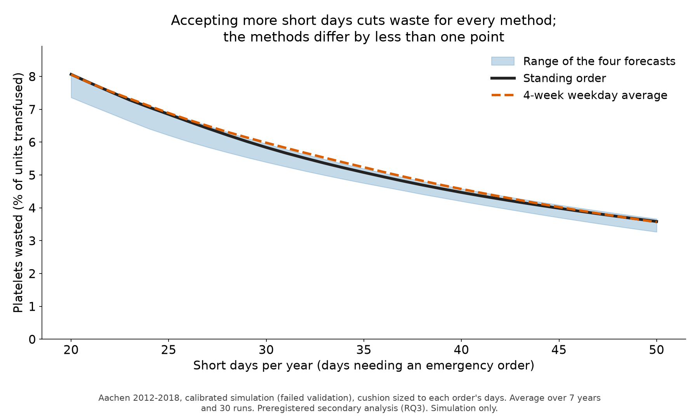

**Educational analysis of public data.** Not a clinical tool and not ordering advice. Every number in this supplement is generated from the result files in `results/m10/` and `study2/results/s2m10/` by `scripts/43_tables_v10.py` (unchanged for v11), except the deviation log in S1, which is reproduced from `paper/prereg_deviations.md`.

# S1. Deviations, clarifications and exploratory observations

Analysis plan: `osf_preregistration_final.md` (final version time-stamped 04:04 US Eastern time, 14 November 2026) with its input manifest `osf_prereg_input_hashes.txt` (03:41). Analyses run 14 November 2026, 04:30 to 05:10 US Eastern time. These times are file time stamps on the analysis computer; they can be edited and are not independently verifiable, and the analysis code was written after the plan. The plan was registered retrospectively on OSF Registries on 14 November 2026, after the analyses were run (https://osf.io/phq42/) [@dixon2026prereg], https://doi.org/10.17605/OSF.IO/PHQ42; this is deviation D8. The registration's title uses "planned"; the attached plan file keeps its original title so that its fingerprint is unchanged. A note listing D1–D8 is to be added to the registration by the author.

### S1.1 Deviations (the plan was not followed exactly)

| # | What the plan said | What was done | Reason | When decided |
|---|---|---|---|---|
| D1 | Section 2.2 orders the work: primary comparisons (step 5), then Stanford (step 6), then sensitivity analyses (step 7). | After validation, the primary, secondary **and sensitivity** simulations for Aachen ran in one batch (script 40). Stanford came after them. The primary table was then made by one script (41) that computes all four comparisons together. | It was simpler to run everything in one go. No choice depended on the sensitivity outputs. The primary specification was fixed before any of them existed. | Before the primary results were seen |
| D2 | The authors' LASSO/RNN reference forecasts were to be compared with SO under the primary setup (Section 5.1 item 6, "2- and 4-day orders only, as in v9"). | They **could not be run** under the calibrated calendar (Mon–Sat). That calendar needs 3-day order totals, and the published LASSO/RNN forecasts exist only as 2- and 4-day totals. They were run instead in the scenarios whose calendars use only 2- or 4-day orders: the v9 base, the Tue–Sat calendar, and daily delivery. Those results are labelled as a substitute. | The data do not allow it (Section 6: "closest feasible version"). | Before the primary results were seen (it was forced by the calibration result) |
| D3 | Sensitivity 5.2.6, cushion chosen in advance: each policy's *k* is set to match the previous year's recorded short days. | It was run for test years **2013–2018 only (6 years)**. *k* is the **mean over the 30 runs** of each policy's matched *k* in year Y−1 (main R1 simulation). It was applied to year Y by linear interpolation along the saved *k*-grid curves, not by a new simulation. | For 2012, a 2011 simulation would need 2010-year cushion units for SARIMA and Chronos-Bolt. Those forecasts do not exist before 31 Dec 2010, and making them would mean new forecast fits, which Section 7 does not allow. Using one *k* per policy and year, as a hospital would set one cushion, was an interpretation, because the plan did not say whether *k* is per run or pooled. | Before the primary results were seen |
| D4 | Section 4.4 / 4.7, Stanford labels. | The plan does not define a Stanford "practically equivalent" interval. The 90% percentile **moving-block bootstrap** interval was used against ±6% of SO's waste, by analogy with the Aachen 90% CI rule. | The plan was silent on this. In the event it made no difference: no Stanford comparison met the equivalence rule. | Before the Stanford results were seen |
| D5 | Section 2.5, Stanford dGB: "script 27 feature construction". | Script 27's features were used: lags and the 7-day mean relative to the past-28-day mean, with the target relative to the past-28-day mean. The holiday flags are **US-California** holidays instead of NRW, as in S2-1. Forecasts are clipped at 0, as for S2-1 GB. | An NRW holiday calendar makes no sense for a US hospital. Clipping matches the S2-1 GB settings the plan names. | Before any Stanford simulation |
| D6 | Section 5.2.3, life-on-arrival sweep "p3 = 0 to 1 in steps of 0.1". | The calibrated value is p3 = 0, which is the main scenario, so it was not run twice. The grid values p3 = 0.30 and 0.43 were run as named. | It would have duplicated the main scenario. | Before the primary results were seen |
| D7 | Section 5.3, NHSBT monthly issues (optional exploratory check). | **Not used.** | It was optional, and nothing needed it. No file was downloaded. | — |
| D8 | Section 2.2 and the plan's front matter: register the plan on OSF before starting the analyses. | The plan was finalised (04:04 ET) and its inputs fingerprinted (03:41 ET) before the analyses (04:30–05:10 ET), but it was registered on OSF only after the analyses: it was registered retrospectively later on 14 November 2026. | An OSF draft was mistaken for a submitted registration. | Found after the analyses |

### S1.2 Clarifications (how the plan's wording was put into code; not deviations)

1. **Compute rule (2.4.3).** The full 2,700-combination grid with all 30 runs took 7.5 minutes, so the 10-run screening step was not needed and was not used.
2. **Recorded calibration targets (2.4.2).** These were recomputed from the public file and asserted equal to the analysis plan's table: 8.25%, 6.53, the weekday shares to 0.1 point, and short days 25/26/40. The validation targets were checked the same way: 9.74%, 8.82, and short days 40/31/21/38/35/42/31.
3. **"Singular fit" for the mixed model (4.3).** This was taken to mean an estimated random-intercept variance below 10⁻⁸ × the residual variance, or a statsmodels warning that the fit is on the boundary or singular. "Did not converge" means `converged = False`, or a convergence warning. None of the four **primary** fits triggered the fallback. Some secondary fits did, and each one is labelled in the output.
4. **Trade-off curve (4.2, item 3).** A short-day level counts as "cannot be reached" in a year for a policy if any of the 30 runs could not reach it. That happens when the run is already below the level at *k* = 0, or never gets down to it. For the main R1 simulation, no year-level combinations were excluded.
5. **Weekday shares after a logging lag (2.4.3 G).** "+1" and "+2" move each weekday's simulated waste forward by 1 or 2 days. "next_workday" moves Saturday and Sunday waste to Monday. The lag is applied to totals over the scoring window. Waste % is unaffected.
6. **Matching.** This is the existing `lib_m5.match_at` rule, re-implemented as weights so that block and weekday outcomes use the same interpolation. It was checked against `match_at` on the synthetic series. At the recorded-short-day target, no run was ever unmatched, and none was below its target at *k* = 0, in any scenario. At the fixed 20-short-day target, one run in the Mon–Fri calendar sensitivity never got down to 20 short days even at *k* = 10. That run was dropped, as the plan says. Fixed-target results are not analysed for that calendar anyway. The *k* grid was extended to 10 only in 7 policy-years: Mon–Fri calendar ×6, Tue–Sat ×1.
7. **Code checks.** `scripts/37_m10_selftest.py` checks the new simulator on the **synthetic** teaching series and confirms it matches `lib_m4.simulate` exactly. It covers both calendars, grouped and pooled stock, and standard and expiry-aware ordering. A regression check also confirmed that the new simulator, with the v9 configuration and constant cushion, reproduces the published v9 standing-order waste for every year 2012–2018 exactly (for example, 2012: 7.984% vs 7.984%).
8. **Fallbacks to WA4 (4.10).** There were 0 in every test-year simulation. In calibration there were 6 origins per order length, all in the warm-up of 2009, where the 2008 standing order would need 2007 data.
9. **Chronos-Bolt at Stanford.** The same published model (`amazon/chronos-bolt-small`) was used, with chronos-forecasting 2.3.2 and torch 2.15.0 (CPU). It was installed in a separate environment (`.venv-chronos`) because the main environment did not have it. No sign-in, no token and no upload were involved.
10. **Input fingerprints.** All 35 SHA-256 fingerprints in `paper/osf_prereg_input_hashes.txt` were rechecked before the analyses and were unchanged.
11. **Stanford forecasts before simulation.** The three new Stanford forecasts (SO, dGB, CB) were made while the Aachen calibration was running. No Stanford simulation was run until after the Aachen primary results.

### S1.3 Exploratory observations (not in the analysis plan; labelled wherever they appear)

- **E1.** The calibration over-fitted. The chosen configuration gave 7.7% waste in 2009–2011 but 5.2% in 2012–2018, against 9.7% recorded.
- **E2.** Under the documented Tue–Sat calendar, changing the standing order's cushion from constant (R2, v9) to order-sized (R1) raised its matched waste from about 8.5% to 11.5%. This comes from setting the v9-base sensitivity (R1) side by side with the v9 numbers (R2). It explains why the v9-base sensitivity numbers differ from v9.

# S2. All Aachen sensitivity analyses

Forecast minus standing order, waste in percentage points (95% CI), order-sized cushion (R1), matched to each year's recorded short days, 30 runs, 2012–2018. Unadjusted; for context only. The calibrated main scenario uses Monday-to-Saturday deliveries, all units arriving with 4 days of life and heavy shortfalls; each row changes one thing. The uncalibrated v9 configuration (Tuesday-to-Saturday deliveries, 30% of units arriving with 3 days, 10% shortfalls) is reported because the plan requires it after a failed calibration.

: **Table S2.** Sensitivity analyses at Aachen.

{{TABLE:sensitivity_v10}}

**Reading the table.** SARIMA's point estimate is below the standing order's in every scenario. The gap is large only when the calendar includes a 4-day weekend order (Tuesday to Saturday, Monday to Friday). Detrended gradient boosting gets clearly worse as more units arrive with only 3 days of life. These are exploratory.

# S3. Source authors' reference forecasts (substitute analysis, deviation D2)

The published LASSO and recurrent neural network (RNN) forecasts exist only as 2- and 4-day totals, so they could not run under the calibrated Monday-to-Saturday calendar, which needs 3-day totals. They were run instead in scenarios whose orders cover only 2 or 4 days. Forecast minus standing order (percentage points, 95% CI).

: **Table S3.** Reference forecasts with clinical inputs (substitute analysis).

{{TABLE:refmodels_v10}}

# S4. Stanford: other shortage targets and reference models

: **Table S4a.** Stanford, forecast minus standing order at 0 and 25 short days (percentage points; 95% moving-block bootstrap CI; unadjusted, secondary).

{{TABLE:stanford_sens_v10}}

: **Table S4b.** Stanford reference models that use clinical data (secondary), and the 4-week weekday average, against the standing order at the primary target of 5 short days.

{{TABLE:stanford_ref_v10}}

# S5. Forecast accuracy at Aachen (descriptive only)

Mean absolute error in units, averaged over test years 2012–2018. Accuracy was known before the plan was written, so it is not a tested outcome.

: **Table S5.** Mean absolute error by horizon.

{{TABLE:accuracy_v10}}

# S6. Trade-off curves and the cushion chosen in advance

{width=100%}

**Cushion chosen in advance (sensitivity 5.2.6; deviation D3).** Each policy's cushion was set from the previous year's matched cushion and then applied without looking at the test year. Short days were then no longer matched, so waste gaps mix waste and service. Year-to-year swings were too large to say anything (Table S6).

: **Table S6.** Cushion chosen in advance, 2013–2018 (6 years). Gap = policy minus standing order, t-based 95% CI over years.

{{TABLE:cushion_advance_v10}}

# S7. Calibration details

All 2,700 combinations (5 calendars × 15 life-on-arrival mixes × 4 logging delays × 3 demand types × 3 shortfall levels) were run with 30 runs on 2009–2011, standing order only. Loss = ((W − 8.25)/1.0)² + ((E − 6.53)/1.5)² + (TVD/0.10)². The chosen setting had loss 6.953, with no other combination within 5% of it; the uncalibrated v9 setting ranked 1,382nd (loss 59.666). The full grid is in `results/m10/38_calibration_grid.csv` and the time-stamped report in `results/m10/38_calibration_report.md`. Per-year validation results are in `results/m10/39_validation_per_year.csv`.

# S8. Reporting checklist (STRESS, simulation studies)

| STRESS item | Where |
|---|---|
| Objectives and model purpose | Main text Section 1; analysis plan RQ1–RQ6 |
| Model logic and components | Main text Sections 2.4 and 2.8; code `scripts/lib_m10.py`, `study2/scripts/lib_s2.py` |
| Data and input parameters | Main text Section 2.2; calibration S7 |
| Experimentation (runs, seeds, warm-up) | 30 common random-number runs, seeds 1000–1029; one-week warm-up; scoring 8 January to 18 December |
| Verification and validation | Code self-test on synthetic data (`scripts/37_m10_selftest.py`); validation Table 1 (failed) |
| Implementation | Python; software versions in `requirements.txt`; Chronos-Bolt in a separate environment (S1.2 item 9) |
| Code access | https://github.com/dixonlj/Platelet-forecast (private at the time of writing; to be made public before posting), archive [Zenodo DOI – pending] |

# References

::: {#refs}
:::
