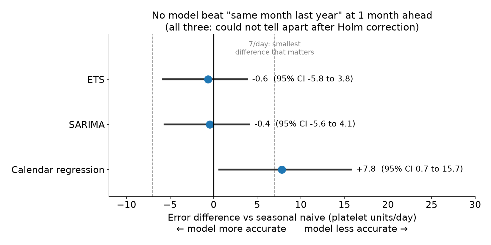
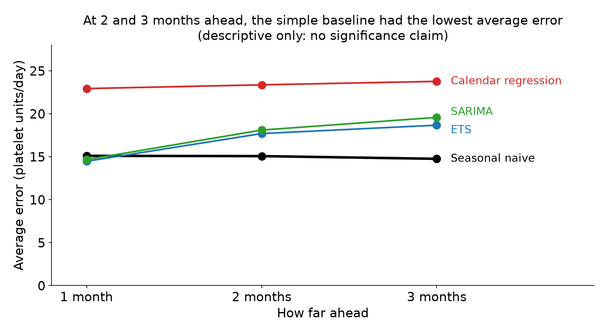

# Study 2: confirmatory results summary (NHSBT monthly platelet issues)

**Status:** confirmatory run started 19 November 2026 at 11:48:52 AM ET and finished at 11:49:58 AM ET (America/New_York).
**Pre-registration:** https://osf.io/vrh2u/ (DOI 10.17605/OSF.IO/VRH2U), registered 19 November 2026 at 06:20:00 UTC (1:20:00 AM ET).
**Affiliation:** Independent researcher. Educational, advisory-only. Not clinical advice and not an ordering tool.
**Data:** public NHSBT workbook, dated snapshot (not redistributed). No hospital, patient, vendor or credentialed data.
**Who did the work:** Grok Bot ran the frozen code and wrote this summary. It has not had a human statistician's or transfusion-medicine expert's review yet.

---

## The answer in one paragraph

We asked whether three standard models (ETS, SARIMA and a calendar regression) forecast **next month's** national platelet issues more accurately than the simplest sensible rule, "same month last year" (seasonal naive). **None of them did.** ETS and SARIMA differed from the baseline by less than 1 unit/day on average (95% intervals about −6 to +4 units/day, against roughly 680 units/day issued). The calendar regression was 7.8 units/day **worse** on average. Its bootstrap interval did not include zero, but after the pre-specified Holm correction its test was not significant (adjusted p = 0.067). Under the pre-registered rule, which needs **both** checks to agree, none of the three could be told apart from "same month last year". Not being able to tell them apart is not proof that they are equal. This is a null result, and a null result is a legitimate finding.

---

## Primary result (confirmatory): 1 month ahead, platelets, units per day

36 test months (November 2022 to October 2025). Every method had a forecast for all 36 months, so no months were dropped from any pair.

| Method | MAE (units/day) | Seasonal naive MAE | Difference (method − naive) | 95% block-bootstrap CI | DM-HLN p (raw) | Holm-adjusted p | Holm rejects? | Verdict | Practical (7/day) | Fit reliability |
|---|---|---|---|---|---|---|---|---|---|---|
| ETS | 14.46 | 15.10 | −0.63 | −5.82 to 3.82 | 0.8014 | 1.0000 | No | Could not tell them apart | No claim | ok (0 of 36 origins omitted) |
| SARIMA | 14.66 | 15.10 | −0.44 | −5.63 to 4.07 | 0.8649 | 1.0000 | No | Could not tell them apart | No claim | ok (0 fallback, 0 omitted) |
| Calendar regression | 22.93 | 15.10 | **+7.83** | **0.66 to 15.74** | 0.0223 | 0.0669 | No | Could not tell them apart | No claim | ok |

How to read this:
- **MAE** = mean absolute error: on average, how many platelet units per day the forecast was off by. Lower is better.
- A **negative** difference means the model had lower error than the baseline. A positive difference means it had higher error.
- **The rule (fixed in advance):** a model is "better" (or "worse") only if the Holm-corrected test is significant at 5% **and** the bootstrap interval excludes zero. A practical claim needs that **and** a difference of at least 7 units/day with the whole interval at least 7 away from zero.
- **ETS and SARIMA:** tiny differences, wide intervals that include zero, large p-values. Clearly "could not tell apart".
- **Calendar regression:** the point estimate is just over 7 units/day worse, and the interval excludes zero, so there is a hint that it was worse. But the Holm-adjusted p of 0.067 is above 0.05, and the two checks must agree, so the pre-specified verdict is "could not tell them apart". We do **not** call it "worse". (Even if it had been, the interval runs down to 0.66, far below 7, so it could not have earned a "practically meaningful" label.)
- **Descriptive lag-2 check** (not part of the verdict): with 2 Newey–West lags the p-values were ETS 0.804, SARIMA 0.865, regression 0.053. That is consistent with the primary result.
- **Unreliable labels:** none on the primary platelet results.
- **How precise is this? (post hoc, descriptive only; not part of the verdict.)** The 95% intervals for ETS (−5.82 to 3.82) and SARIMA (−5.63 to 4.07) lie entirely within ±7 units/day. So, for these two methods, a difference as large as the pre-stated smallest meaningful difference looks unlikely. This was **not** a pre-registered equivalence test, and the intervals may be somewhat too narrow (next point). The regression's interval (0.66 to 15.74) includes 7, so it **cannot rule out a meaningful worsening**.
- **The bootstrap intervals may be a bit narrow.** With only 34–36 months per comparison, percentile block-bootstrap intervals tend to run narrower than they should. Across all 141 rows of the comparisons table, 20 intervals exclude zero, but in 15 of those 20 the DM test's p-value is 0.05 or above. This is why the plan requires the interval **and** the Holm-corrected test to agree: the confirmatory verdict is protected. It also means the regression's interval excluding zero is **a hint, not a finding**.

---

## Secondary horizons (descriptive only: no "better" or "significant" wording)

Platelets, units per day, all test months:

| Horizon | n | Seasonal naive | ETS | SARIMA | Calendar regression |
|---|---|---|---|---|---|
| 1 month | 36 | 15.10 | 14.46 | 14.66 | 22.93 |
| 2 months | 35 | 15.07 | 17.69 | 18.10 | 23.36 |
| 3 months | 34 | 14.75 | 18.67 | 19.58 | 23.77 |

Differences vs naive (95% CI): 2 months: ETS +2.63 (−3.05 to 7.97), SARIMA +3.03 (−2.54 to 8.44), regression +8.30 (0.76 to 17.15). 3 months: ETS +3.92 (−0.71 to 8.90), SARIMA +4.82 (0.30 to 9.82), regression +9.01 (1.13 to 18.29).

At 2 and 3 months the baseline had the lowest average error, and the models' errors grew with the horizon while the baseline's did not. This is descriptive only. No winner is declared.

---

## Sensitivity analyses (descriptive)

**Dropping September and October 2025** (the two months outside the sheet's stated period), 1 month ahead, 34 months: ETS −1.54 (−6.69 to 2.88), SARIMA −1.40 (−6.54 to 3.01), regression +7.86 (0.55 to 16.20). This is the same picture as the primary analysis.

**COVID sensitivity** (March 2020–December 2021 treated as missing; the seasonal naive uses 2019 for November and December 2022), platelets, 1 month ahead: ETS −2.91 (−7.04 to 1.11; 34 paired months, 2 ETS origins omitted), SARIMA +0.30 (−2.19 to 2.99; 11 of 36 origins on the fallback), regression −1.20 (−5.27 to 3.05). In this version the regression no longer looks worse than the baseline. That suggests its poor primary result is mostly caused by the COVID months distorting its fitted trend and month effects. This is an interpretation of a descriptive result, not a confirmed finding.

**Unreliable label (only one in the whole run):** ETS for red cells in the COVID sensitivity had 24 of 36 origins omitted (67%), so it is labelled **"treat as unreliable"**. As the plan says, the label is reported and does not change any verdict.

**A problem to flag in the COVID sensitivity (not the primary result):** at a few origins the SARIMA fits produced absurd forecasts that did **not** trigger the pre-specified failure rule. No exception or warning was raised, statsmodels reported the fit as converged, and the forecast was a finite number, so rules (a) to (f) all passed. The worst cases:
- FFP, origin April 2023: a forecast of about −6 × 10¹¹ units/day. This makes the COVID-sensitivity FFP SARIMA MAE about 1.7 × 10¹⁰, which is meaningless.
- FFP, origin September 2023: a forecast of about −374 units/day.
- Red cells, origin October 2023: about 257 units/day against roughly 3,800 actual.
- Cryoprecipitate: a few origins were off by about 50–100 units/day.

What the reviewer found when refitting all 288 SARIMA models (2 runs × 4 products × 36 origins) without changing any frozen output:
- **6 fits broke, all in the COVID sensitivity:** red cells at the October 2023 origin; FFP at April 2023 and September 2023; cryoprecipitate at April 2023, November 2023 and January 2024. These are the same origins that show the absurd forecasts in `forecasts_long.csv`.
- **All 6 used the main specification**, (0,1,1)(0,1,1)12, not the fallback. All 6 reported `converged = True`. In each, the seasonal moving-average coefficient came out between 10¹³ and 10¹⁵ (a sensible value is between −1 and 1), and 5 of the 6 had a residual variance of essentially zero.
- **Likely cause:** the frozen code (`inference.py`, line 429) fits SARIMA with `enforce_stationarity=False, enforce_invertibility=False`. With 22 months set to missing, seasonal differencing across the COVID gap leaves little usable data, and the unconstrained estimate can run off to absurd values. The reviewer's refit of those 6 origins with statsmodels' default constraints gave sensible forecasts. That refit is not part of these results. **The plan's text never mentions these two settings**, although they are inside the hashed, registered code.
- **The "ok" labels are misleading here.** The SARIMA fallback shares (25–31%) stayed under the 50% "unreliable" threshold, and broken main-specification fits are not counted at all. So the tables still show **"ok"** next to these rows, including next to an FFP MAE of about 1.7 × 10¹⁰ units/day and a red-cell SARIMA MAE of 212.52 against the baseline's 116.63 (1 month ahead).
- **COVID-sensitivity SARIMA results for FFP, red cells and cryoprecipitate are not interpretable at any horizon, despite their "ok" label.** This is a gap in the pre-specified failure rule, not a coding bug: the rules check whether the optimiser *says* it worked, not whether the answer makes sense. It should be stated as a limitation in any write-up.
- **The COVID-sensitivity *platelet* SARIMA result is unaffected.** It had no broken fits, so +0.30 (−2.19 to 2.99) stands as reported.
- **Nothing confirmatory is affected.** The main run has no missing months. All 144 main-run SARIMA fits are sensible, with 0 fallbacks, 0 omissions and no warnings in the main run. Holm uses only the three main-run platelet tests.

The frozen code and outputs were **not** changed, and nothing was re-run for this summary, as the plan requires.

**Secondary products (descriptive), 1 month ahead, all months, difference vs naive (95% CI):**
- Red cells (naive MAE 116.61): ETS −11.04 (−37.96 to 13.54), SARIMA −6.90 (−33.19 to 17.70), regression +16.14 (−21.54 to 50.90), regression with the April 2024 shift +19.52 (−12.73 to 50.70).
- FFP (naive MAE 19.02): ETS +0.63 (−4.14 to 5.80), SARIMA +0.75 (−4.30 to 6.10), regression +8.02 (−0.27 to 16.57).
- Cryoprecipitate (naive MAE 5.11): ETS −0.02 (−1.17 to 1.15), SARIMA +0.14 (−1.09 to 1.38), regression −0.23 (−1.33 to 0.92).
- Red-cell checks (test period from April 2024, n = 19; before April 2024, n = 17): every interval includes zero at 1 month. Full tables are in `nhsbt_confirmatory/comparisons_vs_naive.csv`.

Twenty of the 141 rows in the comparisons table have an interval that excludes zero (the 20 include the confirmatory regression row; among the 138 descriptive rows it is 19). That is about 14%, more than the roughly 5% chance alone would give. Only 7 of the 141 have a raw DM p below 0.05. These comparisons overlap heavily and are not corrected for multiple testing, so none of them is a finding. The 20 are not random: 10 are the regression or SARIMA trailing the baseline on platelets or FFP (mostly the regression, at all three horizons), 6 are ETS or SARIMA with lower error on red cells, and 4 are COVID-sensitivity cryoprecipitate rows. The recurring pattern (the regression trailing the baseline, and the models' error growing at 2–3 months) is described here, not claimed.

---

## Deviations from the plan

**None in the analysis.** The frozen code ran unchanged, with the exact pre-specified software versions (Python 3.13.5, statsmodels 0.15.0, numpy 2.5.5, scipy 1.18.1, openpyxl 3.1.5), seed 20261118 and 10,000 bootstrap resamples. Three notes:
1. The command was `python3 nhsbt_analysis.py --nhsbt --osf-url https://osf.io/vrh2u/`, run from `study2/prereg/`. The script takes the URL through `--osf-url`, which is how the code was written. This is not a deviation.
2. The COVID-sensitivity SARIMA blow-ups above are a weakness of the pre-specified failure rule, not a departure from it. They are reported, not fixed.
3. The two charts and this summary were made afterwards. They are presentation only and change no numbers.

---

## Timeline check (the real safeguard)

| Event | Time (ET) | Source |
|---|---|---|
| OSF registration date_registered | 19 Nov 2026, 1:20:00 AM ET (06:20:00 UTC) | OSF public API, `public: true`, not archiving, no embargo, not withdrawn |
| Confirmatory run **started** | 19 Nov 2026, 11:48:52 AM ET | creation time of `confirmatory_run_console.log` (also the box command log) |
| Confirmatory run **finished** (manifest `run_at`) | 19 Nov 2026, 11:49:58 AM ET | `nhsbt_confirmatory/run_manifest.json` |

The run started about **10 h 29 min after** the registration timestamp. Note that the manifest's `run_at` is the **finish** time, not the start. The manifest also records `osf_registration: https://osf.io/vrh2u/` and the verified code hashes.

**What can and can't be proven.** The outputs are **not under version control**: the box copy isn't a git repository. So "this was the only NHSBT run" rests on file timestamps and the absence of any other output files, not on a tamper-proof record. The reviewer found no sign of an earlier run, and an independent rerun reproduced 8 of 9 output files byte for byte (the manifest differs only in path and time). Before any public release, the outputs and their hashes should be put under version control, or an output `SHA256SUMS` attached to OSF as a timestamped file. Both of those are public steps and need Liam's OK.

---

## Hash checks done before the run

- `sha256sum -c FROZEN_CODE.sha256`: nhsbt_analysis.py OK, inference.py OK. The same check passed again after the run.
- Local `prereg/` code matches `prereg/osf_upload/` copies, byte-identical by SHA-256.
- All five files attached to the OSF registration were downloaded through the public OSF API and hashed. Each matches the local file:

| File | SHA-256 |
|---|---|
| nhsbt_analysis.py | dcb2f18cf590505db266574b317368cf2d719126644e6d2f064aaf07404354ac |
| inference.py | 0e5248d473a0bb216f1d1e20d7536f0c3401b4e04e11bb3033f66a0528e0bf64 |
| FROZEN_CODE.sha256 | e1e20b897257872703fe24af52724c7d02ed0ba0bcf5d6c17f9c399fb00a2008 |
| SHA256SUMS.txt | 32e9f1ebbf8a1e0ac9bf35ce55485b1de87b77a2c5347aa204252fab60dc90c3 |
| osf_prereg_study2_v3.pdf | 986fb521cd763499560cfc6fc1859c1aa093fd293d8f67bf437913d782924a4d |

- NHSBT snapshot (not uploaded anywhere): f0e3fbc52250d210bfa5bbf655063759b079cb6eebbe0ccee75326c0eab4e696, which matches the plan and SHA256SUMS.txt. The script's own checks (code hashes against FROZEN_CODE.sha256 and plan line 119, then the snapshot hash) also passed.
- Local plan `osf_prereg_study2_draft_v3.md`: 0fd104310839d4c609d16660a9c1679c02ab9f9c928beb58281d34e139d2dea8 (unchanged).

## Output file hashes

| File | SHA-256 |
|---|---|
| nhsbt_confirmatory/primary_result.md | 00bf3f68cf83702606fa4622f1954a68a3e5842492ed482f57cac9a46b776df8 |
| nhsbt_confirmatory/comparisons_vs_naive.csv | 7956738d1ffc614d6e41701eeb210199e44b07c54dcba5d44614f15db3efb055 |
| nhsbt_confirmatory/accuracy.csv | 0736c5fa40d8411c00edf6a48122675a10fadf3f275a3633cb1000fdc652e4da |
| nhsbt_confirmatory/dm_lag2_check.csv | 9e4dcf9284456d71180ba2d85eb6bfb792dd2d3d7dfa99092fc247e0168b7df8 |
| nhsbt_confirmatory/fit_summary.csv | 3a5e245ae4864c6acd8029c65318ae7aca2d67cf28b6b5e3f8d2ee521ea46e9b |
| nhsbt_confirmatory/fit_warning_log.csv | 859f7ffd67b152bb115458d72c5ee2b2bd1af6546aa898cedd42e2e12b00728d |
| nhsbt_confirmatory/run_manifest.json | a96f68b65ae65ec1d32c80804939dba2bbf33f988dd5c9e5511a2049b34c9601 |
| nhsbt_confirmatory/forecasts_long.csv (gitignored: contains NHSBT values) | fd769618e3bd9067ef8006816c5702daa47b2784810e80c14185bf70e4af0783 |
| nhsbt_confirmatory/naive_2021_vs_2019.csv (gitignored: contains NHSBT values) | c62dd47e621ef69dc4043745e39b78c05be44c6bf4cc51ce967f3c14964b5dca |
| confirmatory_run_console.log | 530f1ea19bef024ff35707196ece322e601b7a462f36f8f81f4851f442a01841 |

Chart PNGs are not hashed here, because they are presentation only and may be restyled.

---

## Limits (unchanged from the plan)

These are national monthly supplier issues: not hospital daily demand, not inventory, not waste. The series has 115 monthly points, with 36 in the test window. No power calculation was done. Looked at afterwards and descriptively only, the ETS and SARIMA intervals lie within ±7 units/day, while the regression's interval cannot rule out a meaningful worsening (see the precision note under the primary result). Bootstrap intervals from 36 months may be somewhat too narrow. "Could not tell them apart" means the data cannot separate the methods, not that they are proven equal. Nothing here says how many platelets any hospital should order.

## Sharing notes

Nothing has been pushed, posted or sent. `forecasts_long.csv`, `naive_2021_vs_2019.csv` and the snapshot contain or are NHSBT values and are gitignored. Check the ignore rules in the real repository clone before any push. The other tables, charts and this summary may be shared once Liam approves.

---

## Change log

- **v1** (19 Nov 2026, about 11:55 AM ET): first summary. Kept unchanged as `CONFIRMATORY_RESULTS_SUMMARY_v1.md`.
- **v2** (19 Nov 2026, about 12:45 PM ET): applied Research Reviewer's fixes R1–R6 from `review_confirmatory_results.md`, approved by Liam. No outputs, code, plan or charts changed, and nothing re-run.
  - R1: removed the equivalence wording from the headline paragraph and stated the regression separately.
  - R2: added a post hoc, descriptive precision note (ETS and SARIMA intervals within ±7; the regression's interval can't rule out a meaningful worsening), and updated the Limits section.
  - R3: replaced "as expected by chance" with the actual count (20 of 141 intervals exclude zero) and its pattern.
  - R4: completed the COVID-sensitivity SARIMA disclosure (6 of 288 broken fits, the main specification, `converged = True`, the likely cause in the unconstrained estimation the plan doesn't state, the misleading "ok" labels, platelets unaffected, nothing confirmatory affected). Did not do the optional rerun.
  - R5: added a note that bootstrap intervals may be narrow and that the joint rule protects the verdict.
  - R6: recorded the start time (11:48:52 AM ET) and finish time (11:49:58 AM ET), and noted that the outputs aren't version-controlled.
  - Number check: I recounted from `comparisons_vs_naive.csv`. 20 of 141 intervals exclude zero (19 of 138 descriptive) and 7 of 141 raw p < 0.05, matching the review. Of the 20 intervals that exclude zero, **15** (not the review's 13) have DM p ≥ 0.05; the summary uses 15. The 288-fit refit details (6 broken fits, coefficient sizes, near-zero variance, default-constraint refit) come from the review. The 6 origins match the absurd forecasts in `forecasts_long.csv`, and the `enforce_*=False` setting was confirmed at `inference.py` line 429.

